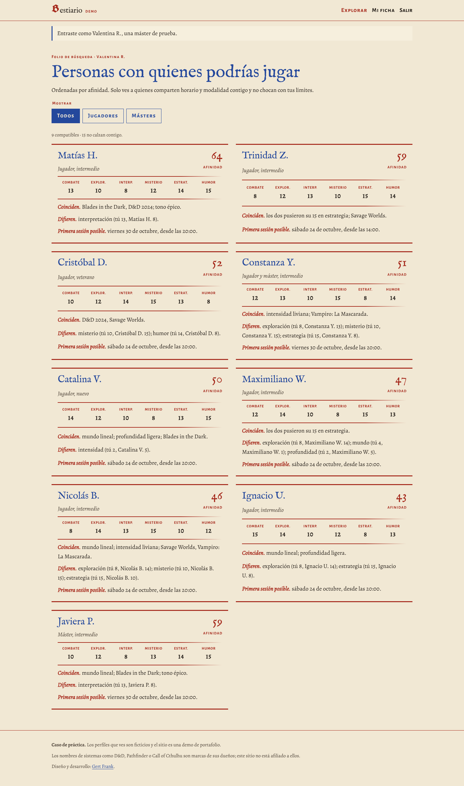

# Bestiario de Jugadores (nombre provisorio)

> **Caso de práctica.** Sitio de "looking for group" para rol de mesa. Los perfiles de la demo son ficticios.

Encuentra personas para jugar rol de mesa según tres preguntas:
1. **¿Pueden jugar juntos?** Horario de las próximas 4 semanas, presencial u online, tipo de campaña e idioma.
2. **¿Lo pasarán bien?** Estilo de juego: seis atributos asignados con dados (standard array) y siete ejes.
3. **¿Se sentirán cómodos?** Líneas y Velos privados, que solo se revelan con interés mutuo.



## Qué demuestra

- **Motor de match propio y explicable** (`match/motor.py`):
  - Filtros duros.
  - Bloqueo por seguridad: si la línea de uno es lo que el otro busca, el match no aparece.
  - Puntaje 0–100 con "coinciden / difieren".
- **Privacidad en el servidor:** las líneas y el contacto solo se envían al navegador si es tu ficha o hay interés mutuo. Hay pruebas que lo verifican.
- **Reglas en la base de datos:** una restricción impide repetir dados, y una validación exige ser mayor de 18. La edad nunca se muestra ni se puede filtrar.
- **25 pruebas automáticas** (`python manage.py test`), incluido el recorrido completo de crear una ficha.
- **HTMX:** filtros y botón "Me interesa" sin recargar la página, con la lógica en Python.
- **Diseño "Bestiario rubricado":** cada perfil se presenta como un bloque de estadísticas de manuscrito iluminado.

## Stack

- Django 5.2 (LTS) + plantillas + HTMX.
- PostgreSQL alojado en Supabase (en desarrollo, SQLite).
- Login con django-allauth: correo y Discord.
- Deploy en Render (`render.yaml` + `build.sh`).

## Cómo correrlo en tu computador

```bash
python -m venv .venv
.venv\Scripts\activate          # Windows  (en Mac/Linux: source .venv/bin/activate)
pip install -r requirements.txt
python manage.py migrate         # crea las tablas
python manage.py poblar_demo     # carga catálogos y 25 perfiles ficticios
python manage.py runserver       # abre http://localhost:8000
```

En la portada, **"Probar con un perfil de demo"** entra como Valentina R., una máster ficticia.

Para el panel de administración, crea un usuario con `python manage.py createsuperuser` y entra a `/admin/`.

## Estructura

```
config/         ajustes y direcciones (urls)
perfiles/       tablas, vistas, administración, datos de demo y pruebas
match/motor.py  el cálculo de compatibilidad (+ match/tests.py)
templates/      HTML de cada página
static/         CSS, fuentes y htmx
docs/           brief, modelo de datos y capturas
```

## Estado

- **Hecho:**
  - Modelos.
  - Motor de match.
  - Datos de demo.
  - Portada, explorar, perfil público e interés mutuo.
  - Login con correo.
  - Crear tu ficha en 5 pasos: calendario "mi mes" (se pinta arrastrando), tirada de dados y checklist de líneas y velos.
- **Siguiente:**
  - Login con Discord (requiere claves de una app de Discord).
  - Deploy en Render.

## Avisos

Los nombres de sistemas como D&D, Pathfinder o Call of Cthulhu son marcas de sus dueños; este sitio no está afiliado a ellos. El *standard array* proviene del SRD 5.1, publicado bajo licencia CC-BY-4.0 por Wizards of the Coast.

---

Diseño y desarrollo: [Gert Frank](https://github.com/gertfrank-dev).
