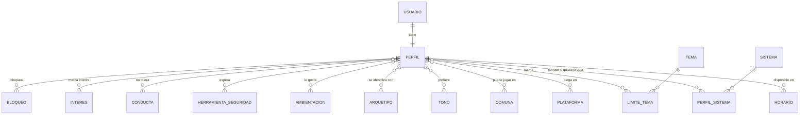

# Modelo de datos — LFG de rol de mesa

> Este documento explica **qué guarda la base de datos y cómo se calcula el match**, antes de escribir código. Cada tabla trae una explicación en palabras simples.

## Primero, tres conceptos

- **Tabla:** como una hoja de Excel. Cada fila es un registro (por ejemplo, una persona) y cada columna un dato (su nombre, su experiencia…).
- **Modelo (en Django):** la forma de describir una tabla con código Python. Django crea la tabla en PostgreSQL a partir de ese código, sin escribir SQL a mano.
- **Relación:** cómo se conectan las tablas. Tiene tres formas:
  - **Uno a uno:** cada usuario tiene **un** perfil.
  - **Uno a muchos:** un perfil tiene **muchos** bloques de horario.
  - **Muchos a muchos:** un perfil conoce **muchos** sistemas, y un sistema lo conocen **muchas** personas. Django lo resuelve con una tabla intermedia.

## Mapa general

Si tu visor no dibuja el diagrama, la lista de abajo dice lo mismo.

---

## 1. Usuario

Lo crea Django automáticamente; django-allauth le agrega el login con correo y con Discord. Guarda correo, contraseña cifrada y fecha de registro. **No lo diseñamos nosotros**, solo lo usamos.

## 2. Perfil (el corazón del sitio)

Una fila por persona, conectada uno a uno con su Usuario. Agrupo sus columnas según las capas del brief.

**Identidad**
| Campo | Qué guarda | Ejemplo |
|---|---|---|
| alias | Nombre visible | "Valentina R." |
| fecha_nacimiento | Solo para verificar que es mayor de 18. **Nunca se muestra, no se busca ni se filtra.** | 1994-03-12 |
| historia | Campo libre: "la mejor sesión que he tenido" | "Una noche de Cthulhu donde…" |
| contacto_discord / contacto_correo | Lo que se muestra al haber interés mutuo | "valen#1234" |
| publicado | Si aparece en las búsquedas | sí / no |
| es_demo | Marca los perfiles ficticios de la demo | sí |

**Capa 1 · Logística**
| Campo | Qué guarda |
|---|---|
| rol | Jugador, máster o ambos |
| modalidad | Presencial, online o ambas |
| comunas *(muchos a muchos)* | Comunas donde puede jugar presencial |
| plataformas *(muchos a muchos)* | Roll20, Foundry, Discord, Owlbear… |
| compromisos | One-shot, campaña corta y/o campaña larga (puede marcar varios) |
| idiomas | Español, inglés… |
| puede_ser_anfitrion | Si puede recibir la mesa en su casa |
| mesa_pagada | "Solo gratis", "acepto pagar" o "cobro" |
| precio | Cuánto cobra o cuánto acepta pagar por sesión (CLP) |

**Capa 2 · Experiencia**
| Campo | Qué guarda |
|---|---|
| experiencia | Nuevo, intermedio o veterano |
| novatos | "Me gusta enseñar", "me da igual" o "prefiero mesas con experiencia" |

**Capa 3 · Estilo**

*Seis atributos, asignados con dados.* Cada uno guarda uno de los valores del *standard array* (15, 14, 13, 12, 10, 8), y cada valor se usa **una sola vez**. La base de datos lo verifica: si alguien intenta guardar dos 15, se rechaza.

| Campo | Qué mide |
|---|---|
| atr_combate | Cuánto disfruta el combate |
| atr_exploracion | Explorar lugares, descubrir secretos |
| atr_interpretacion | Conversar y actuar como su personaje |
| atr_misterio | Intriga, investigación, conspiraciones |
| atr_estrategia | Planificar, resolver encuentros como puzzle |
| atr_humor | Reírse en la mesa, el caos divertido |

*Seis ejes y letalidad (números del 1 al 5):*

| Campo | 1 significa… | 5 significa… |
|---|---|---|
| eje_enfoque | Narrativo | Táctico |
| eje_mundo | Sandbox | Lineal |
| eje_reglas | RAW estricto | Regla de lo genial |
| eje_ritmo | Ágil, escenas cortas | Pausado, escenas largas |
| eje_profundidad | Interpretación ligera | Inmersiva (voces, drama) |
| eje_intensidad | Aventura liviana | Drama intenso |
| letalidad | Mi personaje no muere | Puede morir sin drama |

Más tres listas de selección múltiple: **tonos**, **arquetipos** y **ambientaciones**.

**Capa 5 · Social y vibra**
| Campo | Qué guarda |
|---|---|
| ambiente | 1 = sesión enfocada … 5 = casual con chela |
| alcohol / comida / tabaco | "Sí", "me da igual" o "prefiero que no" |
| busca_amistad | Solo jugar, o también hacer amigos |

## 3. Disponibilidad ("mi mes")

Un perfil tiene **muchos** bloques. Cada fila es una fecha real y un bloque de 2 horas:

| perfil | fecha | bloque |
|---|---|---|
| Valentina | 2026-10-30 (viernes) | 20–22 |
| Valentina | 2026-10-30 (viernes) | 22–24 |
| Valentina | 2026-11-13 (viernes) | 20–22 |

- Se usan **las próximas 4 semanas del calendario real**, para que los turnos de distintas personas se puedan comparar en las mismas fechas.
- Los bloques van de 10–12 a 24–02. Son 8 bloques por día.
- **Frecuencia y duración no se guardan:** se calculan. Dos bloques seguidos el mismo día equivalen a una sesión de 4 horas, y viernes cada dos semanas equivale a frecuencia quincenal.
- Cuando pasa una semana, se agrega la siguiente copiando el patrón de la persona, para que no tenga que volver a marcarlo. Cada mes se le pregunta si sigue igual.

## 4. Sistemas

- **Sistema:** el catálogo, con una fila por juego (D&D 5e, D&D 2024, Pathfinder 2e, Call of Cthulhu, Vampiro, PbtA, Blades in the Dark, OSR…).
- **PerfilSistema:** la tabla intermedia, que dice qué tiene cada persona con cada sistema: *lo conozco* o *quiero probarlo*.

## 5. Contenido y seguridad (Líneas y Velos)

- **Tema:** el catálogo de temas, agrupados por categoría (arañas, gore, suicidio, PvP…). Los temas sexuales van separados en tres: **romance entre personajes**, **contenido sexual explícito** y **violencia sexual**. La violencia sexual viene marcada como *línea* por defecto, y la persona puede cambiarla.
- **LimiteTema:** una fila por persona y tema, con **cuatro** estados:

| Estado | Significa |
|---|---|
| **Lo busco** | Quiero que aparezca; es parte de lo que me gusta |
| **OK** | Puede aparecer sin problema |
| **Velo** | Puede ocurrir, pero fuera de cámara |
| **Línea** | No debe aparecer nunca |

**¿Por qué cuatro y no tres?** La regla del match es: *"si la línea de uno es el tema favorito del otro, no se muestran"*. Para saber cuál es el "favorito" alguien tiene que poder decirlo, y eso es "Lo busco".

**Catálogos de mesa:**
- **HerramientaSeguridad:** X-Card, Sesión Cero, pausas, etc.
- **Conducta:** comportamientos que no tolera, como celulares en la mesa, metagaming o "es lo que haría mi personaje".

**Privacidad:** las filas de LimiteTema solo las ve:
1. La propia persona.
2. Alguien con quien tiene **interés mutuo** (se muestran automáticamente).

Nunca salen en el perfil público. El motor de match **sí** las usa para filtrar, pero solo dentro del servidor: al navegador de otra persona nunca le llega una línea.

## 6. Interés y bloqueo

- **Interes:** "A le interesa B". Cuando existe también "B le interesa A", hay **match mutuo**: cada uno ve las líneas y el contacto del otro.
- **Bloqueo:** "A bloqueó a B". B deja de aparecerle a A y viceversa. Pensado para cuando sea producto real.

## 7. Catálogos simples

**Comuna**, **Plataforma**, **Tono**, **Arquetipo** y **Ambientación** son listas que se editan desde el panel de administración de Django, sin tocar código.

---

## Cómo se calcula el match

Supongamos que **Valentina** busca y el sistema evalúa a **Tomás**.

### Paso 1 · Filtros duros (si falla uno, Tomás no aparece)

1. **Horario:** comparten al menos **dos bloques seguidos** (una sesión de 4 horas) en las próximas 4 semanas.
2. **Compromiso:** hay al menos uno en común (por ejemplo, los dos aceptan campaña larga).
3. **Idioma:** comparten al menos uno.
4. **Modalidad:**
   - Si los dos juegan presencial: deben tener al menos una comuna en común.
   - Si los dos juegan online: al menos una plataforma en común.
   - Si alguno marca "ambas": basta con que calce una de las dos.
5. **Mesa pagada:** si uno cobra, el otro debe aceptar pagar, con un precio que le alcance. Si uno solo juega gratis y el otro cobra, no hay match.
6. **Bloqueo:** ninguno bloqueó al otro.

### Paso 2 · Seguridad (también oculta)

Si un tema es **Línea** para uno y **Lo busco** para el otro, Tomás no aparece. No se muestra como "baja afinidad": **simplemente no aparece**, y nadie sabe por qué. Así nadie puede adivinar las líneas del otro.

### Paso 3 · Puntaje de afinidad (0 a 100)

| Componente | Peso | Cómo se mide |
|---|---|---|
| Atributos (dados) | 35% | Qué tan parecido repartieron sus dados |
| Ejes y letalidad | 25% | Qué tan cerca están en cada número del 1 al 5 |
| Sistemas | 20% | Sistemas en común, incluido "quiero probar" |
| Tono, arquetipo y ambientación | 10% | Coincidencias en esas listas |
| Social y vibra | 10% | Ambiente, alcohol, comida, tabaco y amistad |
| Velos en conflicto | −5 c/u | Si un tema es *Velo* para uno y *Lo busco* para el otro, se resta |

**Ejemplo de ejes:** en "ritmo" Valentina tiene 5 y Tomás 4. La diferencia es 1 de 4 posibles, así que en ese eje se parecen un 75%. Se promedia lo mismo en los siete.

**Ejemplo de dados:** si los dos pusieron su 15 en exploración y su 8 en combate, sus prioridades se parecen mucho aunque el resto varíe. Se compara la diferencia atributo por atributo (la máxima posible es 7, entre un 15 y un 8).

### Paso 4 · Explicación

El puntaje siempre viene con su porqué:

> **87%** · Coinciden en: los dos pusieron su 15 en exploración, ritmo pausado, D&D 5e. Difieren en: letalidad (tú 2, Tomás 5).

### Orden de resultados

Primero por puntaje. A un máster le aparecen antes los jugadores, y a un jugador los másters, pero puede ver a todos.

---

## Datos de la demo

Unas 25 personas ficticias, marcadas con `es_demo = sí`, con perfiles variados para que el match se vea funcionando:
- novatos y veteranos;
- presencial en distintas comunas y online;
- distintos tonos y sistemas;
- al menos un caso donde una línea oculta un match.

## Por decidir

1. **Pesos del puntaje** (35/25/20/10/10): son mi propuesta inicial. Se pueden ajustar después de ver resultados con los datos de la demo.
2. **¿Mostrar el puntaje a quien no tiene perfil completo?** Mi recomendación: no. Para ver matches hay que completar al menos las capas 1, 3 y 4.
3. **Nombre del sitio:** sigue pendiente.
